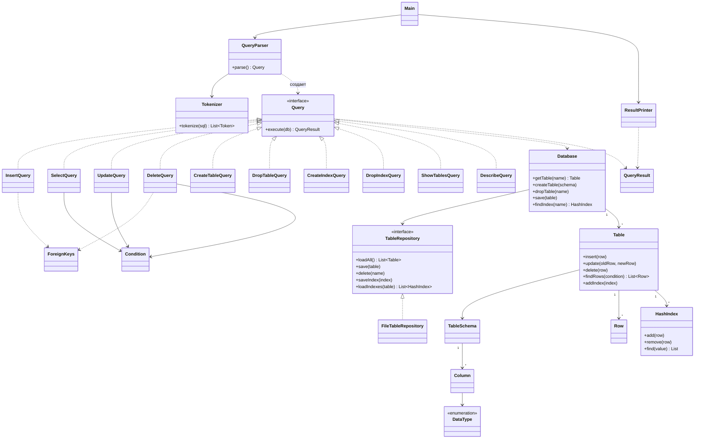
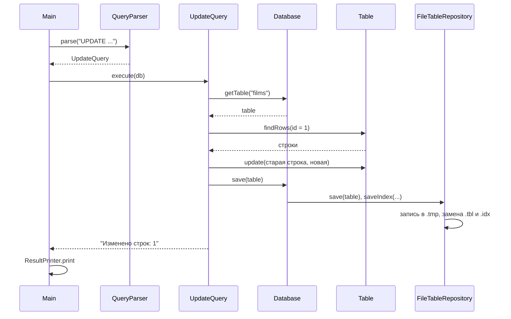
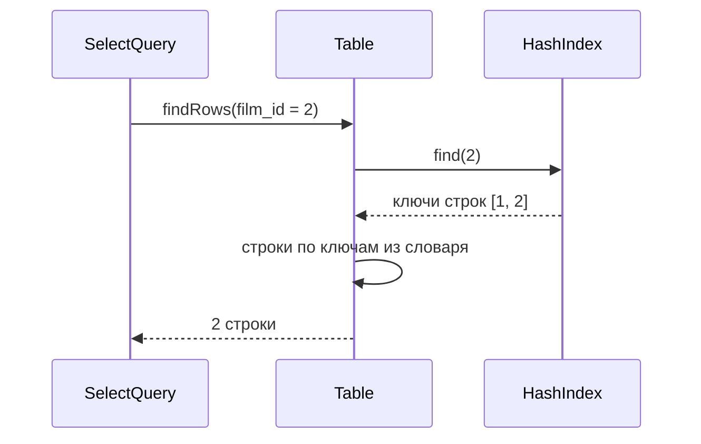

# Упрощенная СУБД

Консольная база данных с SQL-подобными запросами. Таблицы и индексы хранятся в файлах и загружаются при запуске.

Предметная область - кинотеатр: фильмы и сеансы, сеанс ссылается на фильм по ключу.

## Запуск

Из папки проекта:

```
javac -encoding UTF-8 -d out src\*.java
java -cp out Main
```

Таблицы сохраняются в папку `data` в папке проекта. Чтобы сразу посмотреть все возможности, на пустой базе выполните `RUN 'demo.sql'`.

Замеры скорости: `java -cp out Benchmark`.

## Файлы

| Файл | Что в нем |
|-|-|
| `Main.java` | консоль: читает запросы, печатает результат, выполняет скрипты |
| `QueryParser.java`, `Tokenizer.java`, `Token.java`, `TokenType.java` | разбор текста запроса |
| `Query.java` | общий интерфейс запроса |
| `CreateTableQuery.java`, `DropTableQuery.java`, `InsertQuery.java`, `SelectQuery.java`, `UpdateQuery.java`, `DeleteQuery.java` | основные запросы |
| `CreateIndexQuery.java`, `DropIndexQuery.java`, `HashIndex.java` | индексы |
| `ShowTablesQuery.java`, `DescribeQuery.java` | список таблиц и их структура |
| `ForeignKeys.java` | проверки внешних ключей |
| `Condition.java` | условие из WHERE |
| `Database.java` | все таблицы вместе |
| `Table.java`, `TableSchema.java`, `Column.java`, `Row.java`, `DataType.java` | таблица, ее структура, строки и типы |
| `TableRepository.java`, `FileTableRepository.java` | сохранение таблиц и индексов на диск |
| `QueryResult.java`, `ResultPrinter.java` | результат запроса и его печать |
| `DbException.java` | ошибка с понятным текстом |
| `Benchmark.java` | замер поиска с индексом и без |
| `demo.sql` | пример со всеми возможностями |

## Запросы

Один запрос на строку, `;` в конце можно не ставить, регистр команд не важен.

```
CREATE TABLE films (id INT PRIMARY KEY, title STRING, rating DOUBLE, premiere DATE, in_release BOOLEAN)
CREATE TABLE sessions (id INT PRIMARY KEY, film_id INT REFERENCES films(id), hall INT, price DOUBLE)
INSERT INTO films VALUES (1, 'Dune', 8.0, '2021-10-21', FALSE), (2, 'Barbie', 6.8, '2023-07-20', TRUE)
INSERT INTO films (id, title) VALUES (3, 'Up')
SELECT * FROM films
SELECT title, rating FROM films WHERE rating > 7
UPDATE films SET rating = 8.2, in_release = TRUE WHERE id = 1
DELETE FROM films WHERE title = 'Barbie'
CREATE INDEX idx_films_title ON films (title)
DROP INDEX idx_films_title
SHOW TABLES
DESCRIBE films
DROP TABLE films
RUN 'demo.sql'
```

- Типы: `INT`, `DOUBLE`, `STRING`, `DATE`, `BOOLEAN`. Дата пишется строкой `'2021-10-21'`.
- Если `PRIMARY KEY` не указан, ключом становится первый столбец.
- Не указанные в `INSERT` столбцы получают `NULL`. Ключ `NULL` быть не может.
- В `WHERE` одно условие: `=`, `!=` (или `<>`), `<`, `>`, `<=`, `>=`.
- `INSERT` нескольких строк выполняется целиком или не выполняется вообще: если во второй строке повтор ключа, первая тоже не добавится.
- В скрипте для `RUN` один запрос на строку, строки с `--` пропускаются.

Пример:

```
db> SELECT title, rating FROM films WHERE rating > 7
+-------+--------+
| title | rating |
+-------+--------+
| Dune  | 8.0    |
+-------+--------+
Найдено строк: 1
db> INSERT INTO films VALUES (1, 'Copy', 5.0, '2020-01-01', TRUE)
Ошибка: Строка с ключом 1 уже есть, ничего не добавлено
```

Ошибки в запросах (опечатка в команде, буква вместо числа, нет такой таблицы или столбца) не роняют программу: печатается сообщение, и можно вводить дальше.

## Связи между таблицами

Столбец можно объявить внешним ключом: `film_id INT REFERENCES films(id)`. Ссылаться можно только на первичный ключ другой таблицы, типы должны совпадать.

Что проверяется:
- нельзя добавить сеанс с `film_id`, которого нет в `films`;
- нельзя удалить фильм, на который ссылается сеанс, и нельзя поменять ему ключ;
- нельзя удалить таблицу `films`, пока есть таблица, которая на нее ссылается.

```
db> INSERT INTO sessions VALUES (5, 99, 1, '2026-11-17', 300.0, FALSE)
Ошибка: В таблице films нет строки с id = 99
db> DELETE FROM films WHERE id = 2
Ошибка: На строку films с ключом 2 ссылается таблица sessions, ее нельзя удалить или поменять ей ключ
```

## Как хранятся данные

Каждая таблица - отдельный файл `data/имя.tbl`, в него записывается объект `Table` стандартной сериализацией Java. Индекс лежит в своем файле `data/таблица.столбец.idx`. Файлы перезаписываются после каждого изменяющего запроса.

Чтобы таблица не испортилась, если программу закрыть посреди сохранения, запись идет в два шага: сначала во временный файл `.tmp`, потом он одной операцией заменяет старый файл. Если при запуске найден `.tmp`, значит прошлое сохранение не закончилось: он удаляется, а таблица загружается в последнем целом виде. Поврежденный `.tbl` пропускается с предупреждением, остальные таблицы загружаются.

Индекс всегда можно получить из таблицы, поэтому если файл индекса поврежден или устарел (число строк в нем не совпадает с таблицей), индекс строится заново при запуске.

## Индексы

Строки таблицы лежат в словаре по первичному ключу, поэтому `WHERE id = 5` находит строку сразу, без индекса.

Для других столбцов есть `CREATE INDEX`. Индекс - это хеш-таблица: значение столбца -> ключи строк с этим значением. Если в `SELECT`, `UPDATE` или `DELETE` стоит условие `столбец = значение` и по столбцу есть индекс, строки берутся из индекса. Для остальных условий (`>`, `<` и т.д.) таблица просматривается целиком: хеш-индекс умеет искать только равенство.

Индекс обновляется при каждом `INSERT`, `UPDATE` и `DELETE`, так что он всегда совпадает с таблицей.

## Производительность

`Benchmark` заполняет таблицу и ищет строки по условию `столбец = значение` сначала перебором, потом через индекс. Время одного поиска в микросекундах:

| строк | столбец | найдено | без индекса | с индексом | быстрее в |
|-|-|-|-|-|-|
| 1 000 | title | 1 | 41,0 | 4,6 | 9 |
| 1 000 | genre | 91 | 44,3 | 12,9 | 3,4 |
| 10 000 | title | 10 | 189,0 | 0,7 | 261 |
| 10 000 | genre | 1 191 | 187,9 | 61,0 | 3,1 |
| 100 000 | title | 100 | 3 145,4 | 5,7 | 548 |
| 100 000 | genre | 12 514 | 3 264,7 | 843,2 | 3,9 |

`title` - редкое значение (1 строка из 1000), `genre` - частое (каждая 8-я строка).

Без индекса время растет вместе с размером таблицы: просматривается каждая строка. С индексом время зависит только от того, сколько строк нашлось. Поэтому для редких значений индекс дает выигрыш в сотни раз, а для частых всего в 3-4 раза: строк в ответе почти столько же, сколько пришлось бы просмотреть.

## Архитектура

Запрос проходит путь: текст -> токены -> объект запроса -> выполнение над таблицами -> результат -> печать.

Использованные паттерны:
- Command - каждый запрос (`InsertQuery`, `SelectQuery`, ...) это объект с методом `execute`;
- Repository - `TableRepository` прячет, как таблицы и индексы лежат на диске, `Database` работает только через него;
- Iterator - по `Table` можно пройти циклом `for (Row row : table)`.

Ввод-вывод только в `Main` и `ResultPrinter`, остальные классы ничего не печатают.



Что происходит при `UPDATE films SET rating = 8.2 WHERE id = 1`:



Что происходит при `SELECT * FROM sessions WHERE film_id = 2`, если по `film_id` есть индекс:



## Команда

| Участник | Что делал |
|-|-|
| Родион | ядро: типы данных, таблицы, сохранение на диск и восстановление после сбоя, разбор запросов, CREATE TABLE / DROP TABLE / INSERT / SELECT / UPDATE / DELETE, консоль, README |
| Денис (Denischerov2312) | индексы: CREATE INDEX / DROP INDEX, хранение индексов на диске, поиск через индекс, замеры производительности |
| Илья (lamoirex) | связи между таблицами (REFERENCES и проверки), SHOW TABLES, DESCRIBE, выполнение скриптов RUN, демо-скрипт |

## Выводы

Получилась небольшая СУБД, которая понимает основные SQL-запросы, хранит таблицы в файлах и не теряет данные, если программу закрыть во время записи. Разбор запросов отделен от их выполнения, а выполнение от хранения, поэтому индексы и внешние ключи добавились почти без изменений в старом коде.

Хеш-индекс сильно ускоряет поиск по равенству, особенно по редким значениям: на 100 000 строк в сотни раз. Для частых значений выигрыш небольшой, а для условий `>` и `<` хеш-индекс не подходит, там понадобилось бы дерево.

Простое решение с сохранением всей таблицы после каждого изменения удобно и надежно, но на больших таблицах запись становится медленной. Следующим шагом было бы писать на диск только изменения (журнал), а целиком сохранять таблицу изредка.

## Источники

1. Документация Java SE 8: пакеты `java.io` (Serializable, ObjectOutputStream) и `java.nio.file` (Files, StandardCopyOption.ATOMIC_MOVE). https://docs.oracle.com/javase/8/docs/api/
2. Гамма Э., Хелм Р., Джонсон Р., Влиссидес Дж. Приемы объектно-ориентированного проектирования. Паттерны проектирования.
3. Фаулер М. Шаблоны корпоративных приложений (паттерн Repository).
4. Кормен Т. и др. Алгоритмы: построение и анализ (хеш-таблицы).
5. Лекции курса по Java.
