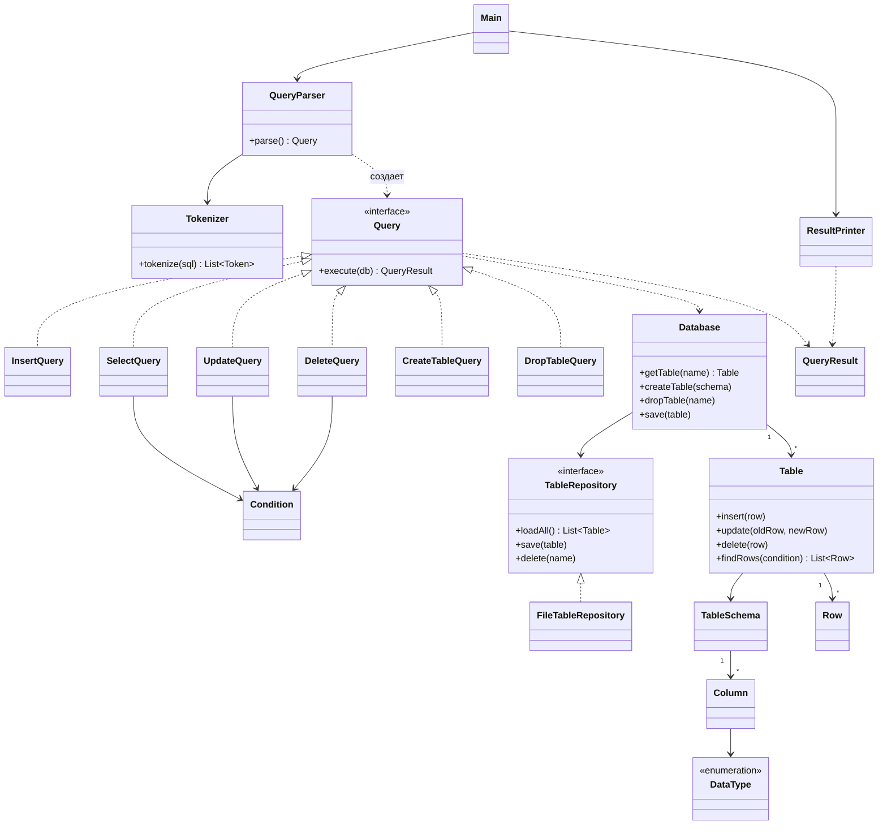
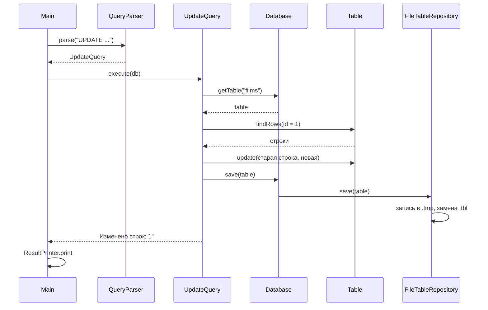

# Упрощенная СУБД

Консольная база данных с SQL-подобными запросами. Таблицы хранятся в файлах и загружаются при запуске.

## Запуск

Из папки проекта:

```
javac -encoding UTF-8 -d out src\*.java
java -cp out Main
```

Таблицы сохраняются в папку `data` в папке проекта.

## Файлы

| Файл | Что в нем |
|-|-|
| `Main.java` | консоль: читает запросы, печатает результат |
| `QueryParser.java`, `Tokenizer.java`, `Token.java`, `TokenType.java` | разбор текста запроса |
| `Query.java` | общий интерфейс запроса |
| `CreateTableQuery.java`, `DropTableQuery.java`, `InsertQuery.java`, `SelectQuery.java`, `UpdateQuery.java`, `DeleteQuery.java` | выполнение каждого вида запроса |
| `Condition.java` | условие из WHERE |
| `Database.java` | все таблицы вместе |
| `Table.java`, `TableSchema.java`, `Column.java`, `Row.java`, `DataType.java` | таблица, ее структура, строки и типы |
| `TableRepository.java`, `FileTableRepository.java` | сохранение таблиц на диск |
| `QueryResult.java`, `ResultPrinter.java` | результат запроса и его печать |
| `DbException.java` | ошибка с понятным текстом |

## Запросы

Один запрос на строку, `;` в конце можно не ставить, регистр команд не важен.

```
CREATE TABLE films (id INT PRIMARY KEY, title STRING, rating DOUBLE, premiere DATE, in_release BOOLEAN)
INSERT INTO films VALUES (1, 'Dune', 8.0, '2021-10-21', FALSE), (2, 'Barbie', 6.8, '2023-07-20', TRUE)
INSERT INTO films (id, title) VALUES (3, 'Up')
SELECT * FROM films
SELECT title, rating FROM films WHERE rating > 7
UPDATE films SET rating = 8.2, in_release = TRUE WHERE id = 1
DELETE FROM films WHERE title = 'Barbie'
DROP TABLE films
```

- Типы: `INT`, `DOUBLE`, `STRING`, `DATE`, `BOOLEAN`. Дата пишется строкой `'2021-10-21'`.
- Если `PRIMARY KEY` не указан, ключом становится первый столбец.
- Не указанные в `INSERT` столбцы получают `NULL`. Ключ `NULL` быть не может.
- В `WHERE` одно условие: `=`, `!=` (или `<>`), `<`, `>`, `<=`, `>=`.
- `INSERT` нескольких строк выполняется целиком или не выполняется вообще: если во второй строке повтор ключа, первая тоже не добавится.

Пример:

```
db> SELECT title, rating FROM films WHERE rating > 7
+-------+--------+
| title | rating |
+-------+--------+
| Dune  | 8.0    |
+-------+--------+
Найдено строк: 1
db> INSERT INTO films VALUES (1, 'Copy', 5.0, '2020-01-01', TRUE)
Ошибка: Строка с ключом 1 уже есть, ничего не добавлено
```

Ошибки в запросах (опечатка в команде, буква вместо числа, нет такой таблицы или столбца) не роняют программу: печатается сообщение, и можно вводить дальше.

## Как хранятся данные

Каждая таблица - отдельный файл `data/имя.tbl`, в него записывается объект `Table` стандартной сериализацией Java. Файл перезаписывается после каждого изменяющего запроса.

Чтобы таблица не испортилась, если программу закрыть посреди сохранения, запись идет в два шага: сначала во временный файл `имя.tbl.tmp`, потом он одной операцией заменяет старый файл. Если при запуске найден `.tmp`, значит прошлое сохранение не закончилось: он удаляется, а таблица загружается в последнем целом виде. Поврежденный `.tbl` пропускается с предупреждением, остальные таблицы загружаются.

## Архитектура

Запрос проходит путь: текст -> токены -> объект запроса -> выполнение над таблицами -> результат -> печать.

Использованные паттерны:
- Command - каждый запрос (`InsertQuery`, `SelectQuery`, ...) это объект с методом `execute`;
- Repository - `TableRepository` прячет, как таблицы лежат на диске, `Database` работает только через него;
- Iterator - по `Table` можно пройти циклом `for (Row row : table)`.

Ввод-вывод только в `Main` и `ResultPrinter`, остальные классы ничего не печатают.



Что происходит при `UPDATE films SET rating = 8.2 WHERE id = 1`:


